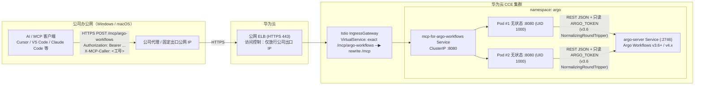

# 华为云 CCE 部署方案与运维指南（Helm Chart · 公网 ELB + Istio IngressGateway）

本文档提供将 **Argo Workflows MCP Server**（`mcp-for-argo-workflows`，镜像版本 `0.6.0`）以 **Helm Chart** 形式部署到 **华为云 CCE `argo` 命名空间**，并通过 **华为云公网 ELB -> CCE Istio IngressGateway** 对团队成员安全提供 HTTPS 访问的完整实施方案（兼容 **Argo Workflows v3.6+ ~ v4.x**）。

- **镜像来源**：静态无依赖 `distroless` 镜像（`CGO_ENABLED=0`、`UID 1000`），可同步至华为云 SWR 或私有仓库（基于 `ghcr.io/lazysnail1024/mcp-for-argo-workflows:0.6.0`）。
- **下游连接（非混用双模式）**：
  - **推荐默认（`argo.mode=argo-server`）**：通过集群内 REST JSON（`--argo-http1=true`）直连 `argo-server.argo.svc.cluster.local:2746`。内置 `NormalizingRoundTripper` 无损兼容 Argo Workflows v3.6 存量单数字段（`spec.schedule` / `mutex` / `semaphore`），支持 Archive 查询与反代子路径，且 Pod 关闭 `automountServiceAccountToken`。
  - **备选（`argo.mode=kubernetes`）**：集群未部署 `argo-server` 时直连 K8s API，Chart 自动创建最小只读 RBAC 并挂载 ServiceAccount。
- **MCP 对外入口**：复用现有公网域名与 Istio Gateway，由 Chart 自动创建 `VirtualService`，精确匹配 `/mcp/argo-workflows` 并重写为后端 `/mcp`；集群内 `Service` 仅使用 **`ClusterIP`**。

> 可直接分发给公司同事的本地客户端连接配置手册，请见：[mcp-client-connect-guide.md](./mcp-client-connect-guide.md)。
>
> 配套 Helm Chart 位于：[deploy/charts/mcp-for-argo-workflows](../deploy/charts/mcp-for-argo-workflows/)，主配置模板：[values-cce-istio.yaml](../deploy/charts/mcp-for-argo-workflows/examples/values-cce-istio.yaml)。

---

## 一、 总体架构与纵深安全防线



### 核心安全与可靠性基线

1. **精确路径隔离**：`VirtualService` 仅精确放行 `/mcp/argo-workflows` 与 `/mcp/argo-workflows/` 并重写为 `/mcp`，**绝不将 `/healthz` 暴露到公网**，且避免与 `/argo`、`/argocd` 前缀冲突。
2. **双代无状态协议与跨副本强安全**：默认 `--stateless --json-response`，同时支持 MCP `2026-07-28`（含 SEP-2243 `HeaderGuard`、跨副本 HMAC-SHA256 MRTR 审批）与 `2025-11-25` 客户端，无需粘性会话、不依赖长连接 SSE。
3. **凭据隔离与防注入**：
   - 入站 `MCP_AUTH_TOKEN`（优先于 Host/Origin 校验，防止未授权枚举白名单）与出站 `ARGO_TOKEN` / `ARGO_TOKEN_REGISTRY_PATH` 完全隔离。
   - 所有 Workflow / 节点 / 日志输出经过自动脱敏与 `<untrusted_workflow_log>` 提示词注入隔离围栏，并受 `64KB` 硬响应熔断器保护。
4. **默认只读硬锁 + 分级写工具**：
   - 默认 `MCP_READ_ONLY=true`、`MCP_TOOLSETS=core,diagnostics`（仅暴露 12 个高信噪比只读/诊断工具）。
   - 如需在受控内网放开 Day-2 运维，可仅开启 `core,diagnostics,ops`（`trigger_workflow` 严格限定只能从已审批 `WorkflowTemplate`/`CronWorkflow` 触发，**拒绝任意裸容器 YAML 执行**）。
   - 仅高权限平台管理员实例才可按需开启 `admin`（`apply_manifest`、`delete_resource`），且高危删除受 MRTR / `confirmName` 与 `MCP_ALLOW_ARCHIVE_DELETE=false` 双重保护。

---

## 二、 部署前检查（在 CCE `kubectl` 终端执行）

### 2.1 查询现有 Istio `Gateway` 与 `VirtualService`

```bash
kubectl get virtualservice -A
kubectl -n <vs-namespace> get virtualservice <existing-vs-name> -o yaml
```

核实并记录：
1. **`spec.hosts`**：目标公网域名（例如 `devops.example.com`）。
2. **`spec.gateways`**：Gateway 引用（如 `istio-system/public-gateway`）。
3. **检查同域名是否存在 `uri.prefix: /` 兜底规则**：若存在旧的宽泛兜底规则，建议为 MCP 分配独立子域名或将 `/mcp/argo-workflows -> /mcp` 插在 `prefix: /` 之前。

### 2.2 核实 `argo-server` 启动参数与 TLS 模式

```bash
kubectl -n argo get deploy argo-server -o jsonpath='{.spec.template.spec.containers[0].args}'; echo
kubectl -n argo get svc argo-server
```

- 若 `argo-server` 包含 `--secure=false`：在 `values` 中将 `argo.serverUrl` 设为 `http://argo-server.argo.svc.cluster.local:2746` 且 `argo.secure: false`。
- 若 `argo-server` 默认以 HTTPS 运行：保持 `https://argo-server.argo.svc.cluster.local:2746`，并通过 `argo.caCert` 挂载集群 CA / `argo-server` 证书（生产环境请勿长期开启 `insecureSkipVerify: true`）。

---

## 三、 创建最小权限 Argo Workflows 只读 ServiceAccount 与 Token

当 `argo-server` 使用 `--auth-mode=client` 或 `--auth-mode=hybrid` 时，为其创建专用只读 ServiceAccount（**禁止直接复用集群 admin Token**）：

```bash
cat <<'EOF' | kubectl apply -f -
apiVersion: v1
kind: ServiceAccount
metadata:
  name: mcp-argo-workflows-readonly
  namespace: argo
---
apiVersion: rbac.authorization.k8s.io/v1
kind: ClusterRole
metadata:
  name: mcp-argo-workflows-readonly
rules:
  - apiGroups: ["argoproj.io"]
    resources:
      - workflows
      - workflowtemplates
      - clusterworkflowtemplates
      - cronworkflows
      - workflowtaskresults
      - workflowtasksets
      - archivedworkflows
    verbs: ["get", "list", "watch"]
  - apiGroups: [""]
    resources:
      - pods
      - pods/log
      - events
    verbs: ["get", "list", "watch"]
---
apiVersion: rbac.authorization.k8s.io/v1
kind: ClusterRoleBinding
metadata:
  name: mcp-argo-workflows-readonly
roleRef:
  apiGroup: rbac.authorization.k8s.io
  kind: ClusterRole
  name: mcp-argo-workflows-readonly
subjects:
  - kind: ServiceAccount
    name: mcp-argo-workflows-readonly
    namespace: argo
---
apiVersion: v1
kind: Secret
metadata:
  name: mcp-argo-workflows-readonly.service-account-token
  namespace: argo
  annotations:
    kubernetes.io/service-account.name: mcp-argo-workflows-readonly
type: kubernetes.io/service-account-token
EOF

# 读取签发的 Bearer Token（Argo Server 要求格式为 "Bearer <jwt>"，本服务会自动补全前缀）
ARGO_TOKEN="Bearer $(kubectl -n argo get secret mcp-argo-workflows-readonly.service-account-token -o jsonpath='{.data.token}' | base64 -d)"
```

> 如需严格限定仅允许查看特定业务命名空间，将上述 `ClusterRole`/`ClusterRoleBinding` 替换为目标命名空间内的 `Role`/`RoleBinding`，并在 Helm values 中配置 `mcp.allowedNamespaces`。

---

## 四、 创建凭据 Secret 并通过 Helm Chart 部署

### 4.1 创建 `mcp-for-argo-workflows-secrets`

```bash
MCP_AUTH_TOKEN="$(openssl rand -hex 32)"
MCP_REQUEST_STATE_SECRET="$(openssl rand -hex 32)"

kubectl -n argo create secret generic mcp-for-argo-workflows-secrets \
  --from-literal=MCP_AUTH_TOKEN="${MCP_AUTH_TOKEN}" \
  --from-literal=MCP_REQUEST_STATE_SECRET="${MCP_REQUEST_STATE_SECRET}" \
  --from-literal=ARGO_TOKEN="${ARGO_TOKEN}" \
  --dry-run=client -o yaml | kubectl apply -f -

echo "=== 请保存并分发给授权同事的入站 MCP_AUTH_TOKEN ==="
echo "${MCP_AUTH_TOKEN}"
```

### 4.2 准备 `my-values.yaml` 并安装

```bash
cp deploy/charts/mcp-for-argo-workflows/examples/values-cce-istio.yaml ./my-values.yaml
vim ./my-values.yaml
```

替换模板中的占位符（`image.repository`、`istio.virtualService.hosts`、`istio.virtualService.gateways`、`mcp.allowedHostHeaders`），然后干跑并安装：

```bash
helm template mcp-argo-workflows deploy/charts/mcp-for-argo-workflows -n argo -f ./my-values.yaml

helm upgrade --install mcp-argo-workflows deploy/charts/mcp-for-argo-workflows \
  -n argo \
  -f ./my-values.yaml
```

> **无 Argo Server 集群**：参考 [values-kubernetes-direct.yaml](../deploy/charts/mcp-for-argo-workflows/examples/values-kubernetes-direct.yaml)，将 `argo.mode` 设为 `"kubernetes"`，无需提供 `ARGO_TOKEN`。

---

## 五、 端到端部署验收

```bash
kubectl -n argo rollout status deploy/mcp-argo-workflows --timeout=120s
kubectl -n argo get pods,svc,pdb,virtualservice -l app.kubernetes.io/instance=mcp-argo-workflows

DOMAIN="<你的公网域名>"
MCP_AUTH_TOKEN="<YOUR_MCP_AUTH_TOKEN>"

# 1. /healthz 严禁对外暴露（期望 404）
curl -sS -o /dev/null -w "Healthz external (expect 404): %{http_code}\n" \
  "https://${DOMAIN}/mcp/argo-workflows/healthz"

# 2. 未携带 Token 必须拒绝（期望 401）
curl -sS -o /dev/null -w "Unauthenticated (expect 401): %{http_code}\n" \
  -X POST "https://${DOMAIN}/mcp/argo-workflows" \
  -H "Content-Type: application/json" \
  -d '{"jsonrpc":"2.0","id":1,"method":"tools/list","params":{}}'

# 3. 携带 Token 拉取默认 12 个只读工具（期望 200）
curl -fsS -X POST "https://${DOMAIN}/mcp/argo-workflows" \
  -H "Authorization: Bearer ${MCP_AUTH_TOKEN}" \
  -H "Content-Type: application/json" \
  -H "Accept: application/json, text/event-stream" \
  -H "X-MCP-Caller: deploy-verify" \
  -d '{"jsonrpc":"2.0","id":1,"method":"tools/list","params":{}}' | head -c 500 && echo

# 4. 穿透 Argo Workflows 后端验证 list_clusters & list_workflows
curl -fsS -X POST "https://${DOMAIN}/mcp/argo-workflows" \
  -H "Authorization: Bearer ${MCP_AUTH_TOKEN}" \
  -H "Content-Type: application/json" \
  -H "Accept: application/json, text/event-stream" \
  -H "X-MCP-Caller: deploy-verify" \
  -d '{"jsonrpc":"2.0","id":2,"method":"tools/call","params":{"name":"list_workflows","arguments":{"limit":5}}}' && echo

# 5. 检查单行脱敏 JSON 审计日志（含 caller，零明文 Token）
kubectl -n argo logs -l app.kubernetes.io/instance=mcp-argo-workflows -c mcp-for-argo-workflows --tail=10
```

---

## 六、 多实例路由与日常运维

- **多 Argo Workflows 实例热重载**：开启 `argo.tokenRegistry.enabled=true` 并挂载 JSON 数组 Secret（`[{"serverUrl":"https://argo-prod.internal:2746","token":"Bearer ...","caCertPath":"..."}]`），修改 Secret 后服务端按文件 `mtime` 自动热重载，无需重启 Pod；且凭据严格与规范化后的 `scheme://host:port` 绑定，杜绝凭据泄漏到任意第三方域名。
- **凭据轮转**：更新 `mcp-for-argo-workflows-secrets` 后执行 `kubectl -n argo rollout restart deploy/mcp-argo-workflows`。
- **升级 / 回滚 / 卸载**：
  ```bash
  helm upgrade mcp-argo-workflows deploy/charts/mcp-for-argo-workflows -n argo -f ./my-values.yaml
  helm -n argo rollback mcp-argo-workflows
  helm -n argo uninstall mcp-argo-workflows
  ```
